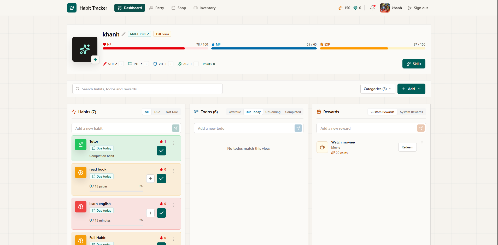
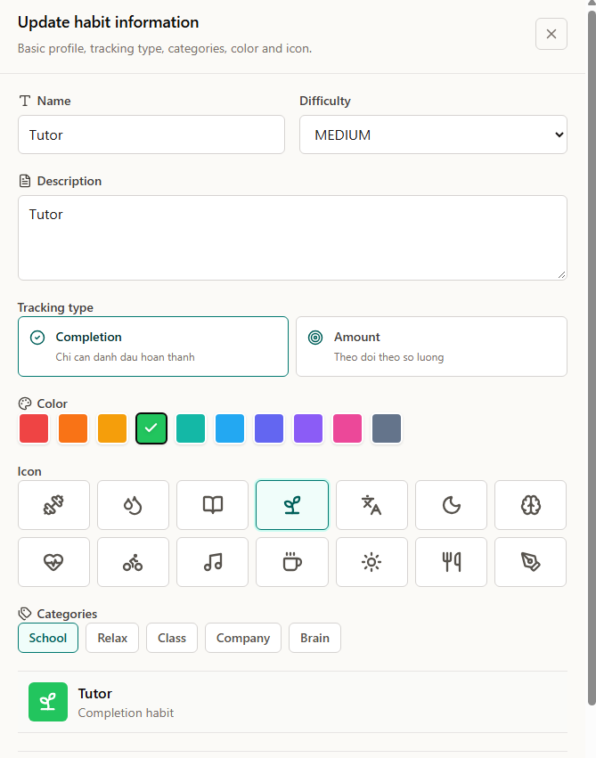
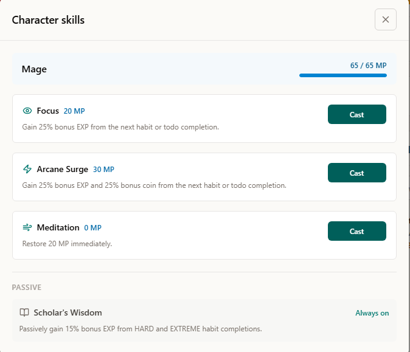
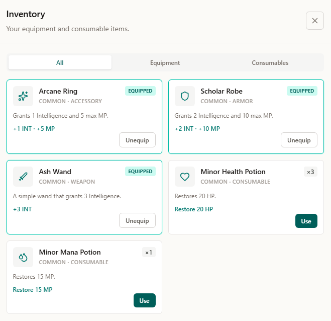
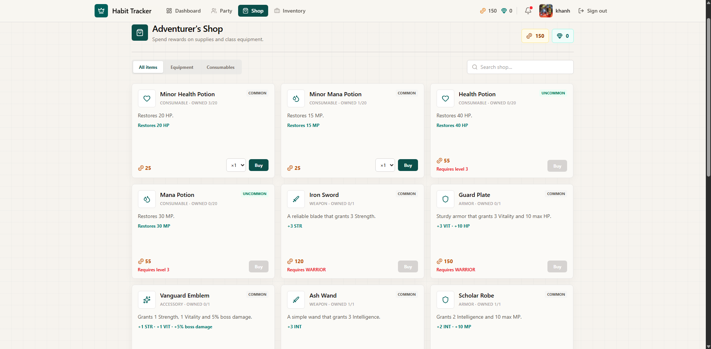
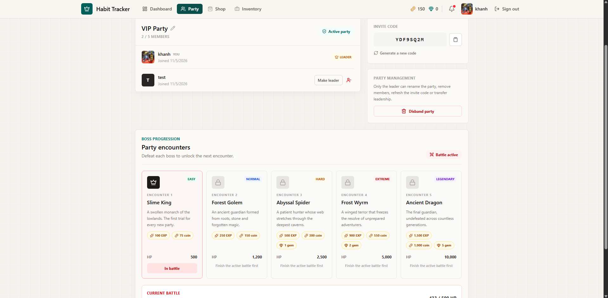

# Habit Tracker RPG

A full-stack productivity platform that turns habit and task management into an RPG experience. Users can build routines, complete todos, develop a class-based character, collect equipment, join a party, and defeat bosses together.

## Live Demo

- **Demo:** [habit-tracker-fe-mocha.vercel.app](https://habit-tracker-fe-mocha.vercel.app)
- **Frontend repository:** [tnKhanh0406/habit-tracker-fe](https://github.com/tnKhanh0406/habit-tracker-fe)

## Screenshots

| Dashboard | Habit details |
| --- | --- |
|  |  |

| Character skills | Inventory |
| --- | --- |
|  |  |

| Shop | Party and boss battles |
| --- | --- |
|  |  |

## Core Features

### Productivity

- Create and manage habits with schedules, targets, difficulty, and progress tracking.
- Create todos with due dates, priorities, categories, and subtasks.
- Grant rewards when habits or todos are completed.
- Reverse rewards and boss damage when a completion is undone.
- Apply penalties for missed habits while avoiding duplicate penalty events.

### RPG Character

- Choose from four classes: **Warrior**, **Mage**, **Ranger**, and **Cleric**.
- Gain EXP, levels, coins, gems, and allocatable stat points.
- Develop STR, INT, VIT, and AGI, with derived HP and MP values.
- Change class after a seven-day cooldown.
- Handle character knockout when HP reaches zero.

### Skill System

- Spend mana to activate class-specific skills.
- Regenerate mana over time and enforce per-skill cooldowns.
- Support instant, passive, next-completion, and next-penalty effects.
- Keep skill rules extensible through policies and effect handlers instead of a single conditional service.

### Items, Equipment, and Shop

- Store stackable items in the player inventory.
- Use consumables and equip class-compatible weapons or armor.
- Calculate effective stats from character attributes and equipment bonuses.
- Automatically unequip incompatible equipment after a class change.
- Purchase shop listings using coins or gems with transactional stock and balance validation.

### Party and Boss Battles

- Create or join a party with up to five members.
- Manage invite codes, leadership transfers, member removal, and party disbanding.
- Unlock five bosses sequentially and let the party leader start encounters.
- Convert habit and todo completions into boss damage using difficulty, class stats, and equipment bonuses.
- Reverse damage when a completion is undone without reviving an already defeated boss.
- Reward contributors who are still in the party when the boss is defeated.

## Tech Stack

| Area | Technologies                                 |
| --- |----------------------------------------------|
| Backend | Java 21, Spring Boot 3, Spring Web           |
| Security | Spring Security, JWT                         |
| Persistence | Spring Data JPA, Hibernate                   |
| Database | PostgreSQL, Supabase                         |
| Schema migration | Flyway                                       |
| Frontend | Vue 3, Vite, Pinia, Vue Router, Tailwind CSS |
| Media storage | Cloudinary                                   |
| Containerization | Docker, Docker Compose                       |
| Deployment | Vercel (frontend), Azure (backend)           |
| Testing | JUnit 5, Mockito                             |

## Architecture

The backend uses a feature-oriented package structure. Each domain owns its controllers, DTOs, entities, repositories, services, policies, and effect handlers where applicable.

```text
src/main/java/com/prj/habittracker
├── auth
├── habit
├── todo
├── reward
├── rpg
│   ├── character
│   └── skill
├── item
├── inventory
├── shop
├── party
├── boss
└── config
```

## Technical Highlights

### Extensible skill engine

Skill behavior is split into policies and effect handlers. This supports multiple effect lifecycles without growing one large `cast` method and makes additional skills easier to introduce.

### Idempotent completion processing

Reward, penalty, and boss-damage records retain their source type and source ID. Repeated requests therefore do not grant the same reward or apply the same damage more than once.

### Transaction-safe boss battles

Boss damage is processed inside a transaction with pessimistic locks on the party and active battle. Each event stores snapshots of the source difficulty, main character stat, equipment damage bonus, and actual damage applied.

### Safe boss reward distribution

When a boss is defeated, the backend intersects active damage contributors with current party members. A unique `(battle_id, user_id)` constraint prevents a contributor from receiving the same battle reward twice.

### Controlled database evolution

Flyway owns schema changes and seed data. Hibernate uses `ddl-auto=validate` to detect mismatches between migrated tables and JPA entities without modifying production schema automatically.

## Prerequisites

- Java 21
- Maven 3.9+ or the included Maven Wrapper
- Node.js 22.18+ for the frontend
- PostgreSQL or a Supabase project
- Docker Desktop (optional)
- Cloudinary account (optional for profile image uploads)

## Environment Variables

Copy `.env.example` to `.env` when running through Docker Compose, then replace the placeholder values:

```env
DB_URL=jdbc:postgresql://your-supabase-host:5432/postgres?sslmode=require
DB_USERNAME=your-supabase-database-username
DB_PASSWORD=your-supabase-database-password

DB_MAX_POOL_SIZE=5
DB_MIN_IDLE=1
DB_CONNECTION_TIMEOUT_MS=30000

JWT_SECRET=replace-with-a-long-random-secret
CORS_ALLOWED_ORIGINS=http://localhost:5173,https://habit-tracker-fe-mocha.vercel.app

CLOUDINARY_CLOUD_NAME=
CLOUDINARY_API_KEY=
CLOUDINARY_API_SECRET=

HOST_PORT=8081
JAVA_TOOL_OPTIONS=-XX:MaxRAMPercentage=75.0 -XX:+ExitOnOutOfMemoryError
```

`DB_URL` must be a JDBC URL beginning with `jdbc:postgresql://`. Real `.env` files and credentials must never be committed.

## Running Locally

### Backend with Maven

Clone the backend repository and enter its directory:

```bash
git clone https://github.com/tnKhanh0406/habit-tracker.git
cd habit-tracker
```

Provide the required environment variables in your terminal or IDE, then run:

```bash
./mvnw spring-boot:run
```

On Windows PowerShell:

```powershell
.\mvnw.cmd spring-boot:run
```

The backend is available at `http://localhost:8081`. Its health endpoint is:

```text
GET http://localhost:8081/actuator/health
```

Spring Boot does not load `.env` by itself when started directly with Maven. Configure the variables in the shell or IDE, or use Docker Compose, which loads `.env` automatically.

### Backend with Docker

After creating `.env` from `.env.example`, run:

```bash
docker compose up --build -d
```

Useful commands:

```bash
docker compose logs -f backend
docker compose restart backend
docker compose down
```

Use `docker compose up -d` when only environment variables change. Rebuild the image after changing Java code, resources, dependencies, or the Dockerfile.

### Frontend

Clone and run the separate frontend repository:

```bash
git clone https://github.com/tnKhanh0406/habit-tracker-fe.git
cd habit-tracker-fe
npm install
npm run dev
```

Create a frontend `.env` file:

```env
VITE_API_BASE_URL=http://localhost:8081/api
```

The frontend is available at `http://localhost:5173`.

## Database Migrations

Flyway executes migrations from `src/main/resources/db/migration` during application startup. Hibernate then validates the resulting schema.

```properties
spring.flyway.enabled=true
spring.jpa.hibernate.ddl-auto=validate
```

Create a new versioned migration for every schema or seed-data change. Do not edit a migration that has already been applied to a shared database.

## Testing

Run backend tests:

```bash
./mvnw test
```

Create the backend artifact without running tests:

```bash
./mvnw package -DskipTests
```

Build the frontend production bundle from the frontend repository:

```bash
npm run build
```

## Roadmap

- Party quests and timed boss encounters
- Pet system
- Item and equipment drops from boss battles
- Party damage contribution leaderboard
- Notifications
- Testcontainers-based integration tests
- Automated CI/CD for backend deployment
